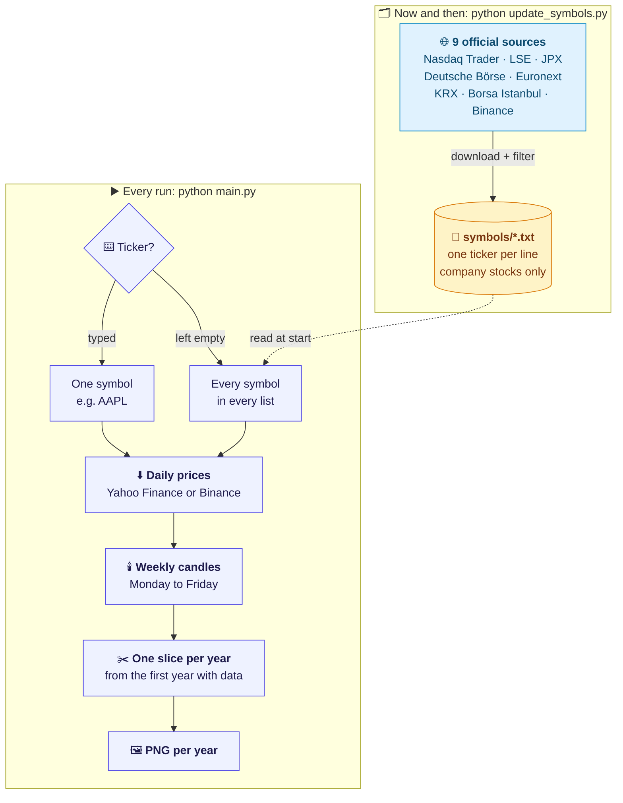
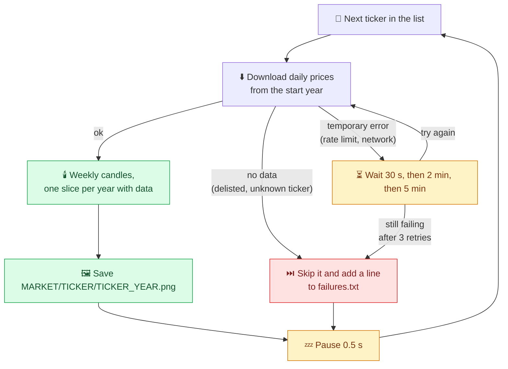

<div align="center">

# 📸 Market Screenshot Generator

**Give it a ticker and a start year.
It saves one weekly candlestick chart per year, styled like TradingView.
Leave the ticker empty and it charts every stock on eight exchanges, plus Binance futures.**

[](CHANGELOG.md)


<br/>


</div>

---

## 📚 Contents

1. [What it does](#-what-it-does)
2. [How it works](#-how-it-works)
3. [Run it](#-run-it)
4. [All markets mode](#-all-markets-mode)
5. [Matching TradingView](#-matching-tradingview)
6. [Project structure](#-project-structure)
7. [Tests and versions](#-tests-and-versions)

---

## 🎯 What it does

| | |
|---|---|
| ⌨️ **Ask** | Prompts for a ticker symbol (`AAPL`, `BTC-USD`, `THYAO.IS` …) and a start year. |
| ⬇️ **Fetch** | Downloads daily prices: stocks from Yahoo Finance, Binance futures from Binance. No account or API key needed. |
| 🕯️ **Build** | Turns daily prices into weekly candles, the same way TradingView does. |
| 🖼️ **Save** | Saves one PNG per year into a new folder for this run. |
| 🌍 **All markets** | With an empty ticker, does the same for ~15,000 symbols across 9 markets. |

---

## 🏗 How it works

There are two separate jobs. **Updating the symbol lists** happens now and then and needs the exchanges' websites.
**Making charts** happens on every run and only reads those lists, so a run never depends on an exchange website being up.



Both modes share the same three steps after the download. That is why a Binance contract and a Tokyo stock end up with identical-looking charts:
only the price source differs, never the candle or chart logic.

---

## 🚀 Run it

**You need:** Python 3.11 or newer.

```bash
git clone https://github.com/siarkonyar/market-screenshot-generator.git
cd market-screenshot-generator
python3 -m venv .venv && source .venv/bin/activate
pip install -r requirements.txt
python main.py
```

```
Market Screenshot Generator v0.1.0
Enter ticker symbol (e.g. AAPL, or leave empty for all markets): AAPL
Enter start year (e.g. 2018): 2019
Fetching AAPL daily data since 2019...
Saved .../screenshots/AAPL_from_2019_2026-11-06_16-57-40/AAPL_2019.png
...
Done. 8 charts saved to .../screenshots/AAPL_from_2019_2026-11-06_16-57-40
```

Every run gets its own folder, named after the ticker, the start year and the time of the request, so earlier runs are never overwritten:

```
screenshots/
└── AAPL_from_2019_2026-11-06_16-57-40/
    ├── AAPL_2019.png
    ├── ...
    └── AAPL_2026.png
```

Tickers use Yahoo Finance's format: `AAPL`, `BRK-B`, `VOD.L`, `7203.T`, `THYAO.IS`, `BTC-USD`.

---

## 🌍 All markets mode

Press Enter without a ticker and the script works through every list in `symbols/`:

| File | Market | Symbols | Example | Symbols come from | Prices come from |
|---|---|---:|---|---|---|
| `NYS.txt` | New York Stock Exchange | 1,902 | `IBM` | Nasdaq Trader symbol directory | Yahoo |
| `NASDAQ.txt` | Nasdaq | 3,192 | `AAPL` | Nasdaq Trader symbol directory | Yahoo |
| `LSE.txt` | London Stock Exchange | 1,248 | `VOD.L` | LSE instrument list | Yahoo |
| `TSE.txt` | Tokyo Stock Exchange | 3,693 | `7203.T` | JPX listed issues | Yahoo |
| `FWB.txt` | Frankfurt Stock Exchange | 463 | `SAP.F` | Deutsche Börse listed companies | Yahoo |
| `EURONEXT.txt` | Euronext Paris + Growth Paris | 612 | `MC.PA` | Euronext stock list | Yahoo |
| `KRX.txt` | Korea Exchange (KOSPI + KOSDAQ) | 2,589 | `005930.KS` | KRX KIND corporate list | Yahoo |
| `BIST.txt` | Borsa Istanbul | 580 | `THYAO.IS` | BIST ALL SHARES index | Yahoo |
| `BINANCE.txt` | Binance USDT perpetual futures | 517 | `BTCUSDT` | Binance futures API | Binance |

The lists hold **company stocks only**. ETFs, funds, warrants, SPACs and foreign duplicate listings are filtered out, so each company is charted once.

### What happens to each symbol

A full run takes many hours, so it is built to keep going when single symbols fail:



- **Each ticker starts at its own first year.** Ask for 2012 and a company that listed in 2015 gets charts from 2015 on. Years without data are simply absent, not blank.
- **The 0.5 s pause** keeps Yahoo and Binance from throttling a run of ~15,000 requests.
- **`failures.txt`** lists every skipped ticker with the reason, one per line (`MARKET<TAB>TICKER<TAB>reason`), so you can check them afterwards.

```
screenshots/
└── ALL_from_2012_2026-11-09_18-00-00/
    ├── NYS/
    │   └── IBM/
    │       ├── IBM_2012.png
    │       └── ...
    ├── BINANCE/
    │   └── BTCUSDT/
    │       ├── BTCUSDT_2019.png
    │       └── ...
    └── failures.txt
```

### Refreshing the lists

The lists are saved in the repo, so a chart run downloads nothing but prices. New listings and delistings show up after a refresh:

```bash
python update_symbols.py            # every market
python update_symbols.py BIST NYS   # only these markets
```

If one exchange's website is down or has changed its file format, that market keeps its old list and the others still update.

---

## 📐 Matching TradingView

| Rule | How |
|---|---|
| **Weekly candles** | Built from daily prices. Monday to Friday, labelled with the Monday. |
| **Holiday weeks** | The candle opens on the first trading day of the week. |
| **Year boundaries** | A week belongs to the year its Monday is in. |
| **Adjustments** | Split-adjusted, not dividend-adjusted (TradingView's default). |
| **Crypto** | Binance daily candles open at 00:00 UTC, and the week runs Monday to Sunday. |

One real week shows all of these at once. AAPL, week of Monday 29 December 2025: the market is closed on Thursday 1 January, and Friday is already in 2026.

| Day | Open | High | Low | Close | |
|---|---:|---:|---:|---:|---|
| Mon 29 Dec 2025 | **272.69** | 274.36 | 272.35 | 273.76 | ← first open of the week = **open** |
| Tue 30 Dec 2025 | 272.81 | 274.08 | 272.28 | 273.08 | |
| Wed 31 Dec 2025 | 273.06 | 273.68 | 271.75 | 271.86 | |
| Thu 1 Jan 2026 | – | – | – | – | market closed |
| Fri 2 Jan 2026 | 272.26 | **277.84** | **269.00** | **271.01** | ← highest high, lowest low, last close |
| **Weekly candle "29 Dec 2025"** | **272.69** | **277.84** | **269.00** | **271.01** | → drawn on the **2025** chart |

Prices usually match TradingView to the cent.

---

## 🗂 Project structure

```
main.py                     # python main.py — asks for a ticker and a year
update_symbols.py           # python update_symbols.py — refreshes symbols/*.txt
symbols/                    # one ticker list per market
chart_screenshots/
├── cli.py                  # prompts, one-ticker runs, per-run folders
├── bulk.py                 # all markets mode: retries, pauses, failures.txt
├── data.py                 # Yahoo prices → weekly candles → years
├── binance_data.py         # Binance futures daily prices
├── charts.py               # the TradingView-style PNG
├── markets.py              # the 9 markets: symbol source + price source each
├── symbol_files.py         # reading and refreshing symbols/*.txt
└── symbol_sources/         # one downloader per exchange
```

Adding a market means one downloader in `symbol_sources/` and one line in `markets.py`.

---

## 🧪 Tests and versions

```bash
python -m pytest --cov=chart_screenshots
```

The tests run offline. Every downloader is tested against small copies of the real file formats, so no test touches an exchange or price API.

Versions follow [semantic versioning](https://semver.org). The changes in each version are listed in [CHANGELOG.md](CHANGELOG.md).
