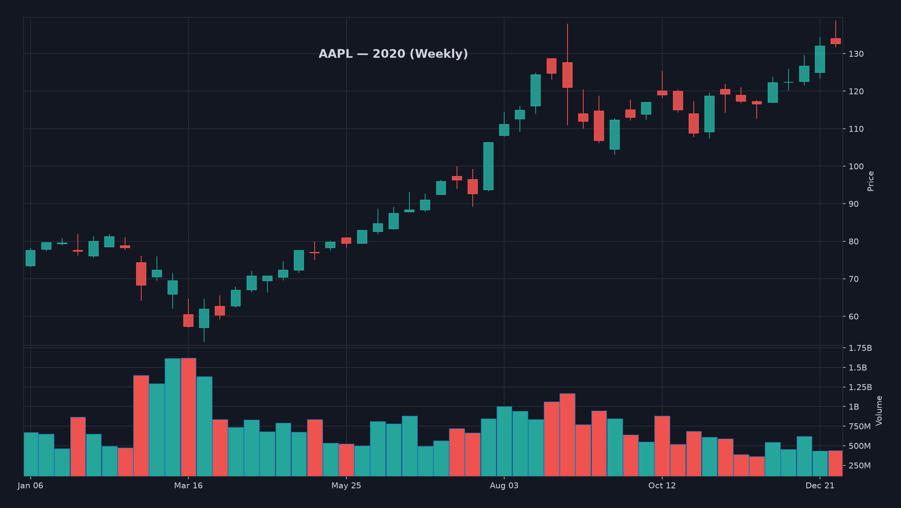

<div align="center">

# 📸 Market Screenshot Generator

**Give it a ticker and a start year.
It saves one weekly candlestick chart per year, styled like TradingView.**


<br/>



</div>

---

## 🎯 What it does

| | |
|---|---|
| ⌨️ **Ask** | Prompts for a ticker symbol (`AAPL`, `BTC-USD`, `THYAO.IS` …) and a start year. |
| ⬇️ **Fetch** | Downloads daily prices from Yahoo Finance. No account or API key needed. |
| 🕯️ **Build** | Turns daily prices into weekly candles, the same way TradingView does. |
| 🖼️ **Save** | Saves one PNG per year into a new folder for this run. |

## 🚀 Run it

**You need:** Python 3.11 or newer.

```bash
git clone https://github.com/siarkonyar/market-screenshot-generator.git
cd market-screenshot-generator
python3 -m venv .venv && source .venv/bin/activate
pip install -r requirements.txt
python main.py
```

```
Enter ticker symbol (e.g. AAPL): AAPL
Enter start year (e.g. 2018): 2019
Fetching AAPL daily data since 2019...
Saved .../screenshots/AAPL_from_2019_2026-11-06_16-57-40/AAPL_2019.png
...
Done. 8 charts saved to .../screenshots/AAPL_from_2019_2026-11-06_16-57-40
```

Each run gets its own folder, named after the symbol, the start year and the time of the request, so earlier runs are never overwritten:

```
screenshots/
└── AAPL_from_2019_2026-11-06_16-57-40/
    ├── AAPL_2019.png
    ├── ...
    └── AAPL_2026.png
```

## 📐 Matching TradingView

| Rule | How |
|---|---|
| **Weekly candles** | Built from daily data. Monday to Friday, labelled with the Monday. |
| **Holiday weeks** | Open on the first trading day of the week. |
| **Year boundaries** | A week belongs to the year its Monday is in. |
| **Adjustments** | Split-adjusted, not dividend-adjusted (TradingView's default). |

> Prices usually match TradingView to the cent. Volume can differ a little, because data vendors count trades from different venues.

## 🧪 Tests

```bash
python -m pytest --cov=chart_screenshots
```
